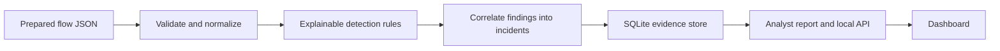

  

<h1 align="center">SentinelMesh</h1>

SentinelMesh is a local defensive investigation demo. It validates prepared network-flow JSON, applies explainable baseline rules, correlates findings into incidents, and produces an evidence-linked analyst report. It demonstrates the workflow without capturing traffic, calling an external model, or changing network controls.

## How it works

SentinelMesh accepts prepared flow records and turns rule matches into evidence-linked incidents for a human reviewer.

Input bounds are checked before analysis. Detection keeps observed flow facts distinct from rule hypotheses; correlation groups related findings and preserves the evidence behind each incident. The interface is read-only: it does not capture traffic or change network controls.

## Run

Requires Python 3.11+ and PowerShell on Windows.

    py -3 -m venv .venv
    .\.venv\Scripts\Activate.ps1
    .\scripts\run.ps1 analyze
    .\scripts\run.ps1 serve

Open http://127.0.0.1:8000. The server refuses non-loopback bind addresses.

## Input and commands

- `analyze` loads `data/sample_flows.json`.
- `analyze --input path\to\flows.json` analyzes a JSON array of flow objects.
- `serve --port 8000` opens the local dashboard.
- `sentinelmesh analyze` works after `pip install -e .`.

Input is limited to JSON flow records (2 MB on CLI; 2 MB per API request), 20,000 rows, known IP addresses, supported protocols, and bounded ports/counters. PCAP parsing is deliberately not enabled in this MVP.

## Safety boundary

Findings and scores are triage hints, not proof or calibrated probabilities. The investigator distinguishes observed flow facts from rule-generated hypotheses. Its tools are read-only. Any response example is recorded as an analyst-approved simulation; it cannot modify a host or network. Use only benign data from an owned or appropriately licensed lab.

## Project map

- `src/sentinelmesh/`: input validation, detection, correlation, SQLite store, evidence report, service, API, CLI.
- `data/`: synthetic flow sample; runtime database is ignored.
- `frontend/`: local analyst dashboard.
- `docs/`: design, safety, and workflow.
- `scripts/`: PowerShell runner and illustrated guide generator.
- `output/`: generated analysis artifacts; runtime databases are ignored by Git.

See `docs/how-it-works.md` for the walkthrough and evaluation boundaries.

