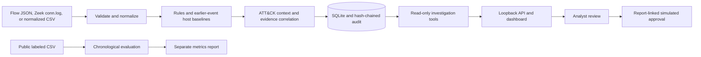

# SentinelMesh

SentinelMesh is a local defensive network-flow triage lab that validates flow metadata, creates evidence-linked findings, and supports analyst review without taking network actions.

## Why it exists

Network alerts are easier to evaluate when each signal points to the records that produced it. SentinelMesh is for students and defenders who want to explore explainable traffic heuristics, incident correlation, offline dataset evaluation, and safe investigation workflows. It is a research/demo tool, not a production intrusion-detection service.

## Demo

```bash
python scripts/generate_sample_data.py
python -m sentinelmesh.cli analyze
python -m sentinelmesh.cli serve
```

The server binds to `127.0.0.1` and prints a random bearer token for that run. The page opens in viewer mode; enter the token to enable analyst-only simulated writes. All findings are hypotheses, and simulated actions never change a host or network.

## Quick start

Python 3.11 or 3.12 is required. The basic application uses only the Python standard library.

**Windows PowerShell**

```powershell
py -3.11 -m venv .venv
.\.venv\Scripts\Activate.ps1
python -m pip install -e ".[dev]"
python scripts/generate_sample_data.py
python -m sentinelmesh.cli analyze
python -m sentinelmesh.cli serve
```

**macOS and Linux**

```bash
python3.11 -m venv .venv
source .venv/bin/activate
python -m pip install -e ".[dev]"
python scripts/generate_sample_data.py
python -m sentinelmesh.cli analyze
python -m sentinelmesh.cli serve
```

Open `http://127.0.0.1:8000`; stop the server with Ctrl+C. `python -m sentinelmesh.cli reset-demo` explicitly clears stored demo records while preserving the audit history. Use it when replacing an existing local fixture with changed flow content.

## Architecture



Input validation bounds file size and row count, rejects unknown fields, and normalizes timestamps. The rules include port activity, high egress, periodic connections, and a rolling per-host egress baseline computed from earlier event-time rows only. Optional NetworkX summaries show components, hubs, and internal path candidates. The LLM investigator is disabled by default, makes no request unless explicitly enabled, and receives no callable tools. See [architecture](docs/architecture.md) and [how it works](docs/how-it-works.md).

## Results and measurements

The deterministic fixture contains 600 synthetic flow records from seed `41`, including benign, port-scan, large-egress, repeated-SSH, and beaconing scenarios. It is generated locally; neither its records nor labels are committed.

| Measurement | Result | Method |
| --- | ---: | --- |
| Synthetic input records | 600 | Generated with `scripts/generate_sample_data.py --count 600 --seed 41` |
| Findings / incidents | 17 / 4 | One isolated local run on the synthetic fixture |
| Parse median | 8.375 ms | Five local runs, Python 3.13; includes JSON file read |
| Detection median | 3.424 ms | Five local runs, Python 3.13 |
| Correlation median | 0.334 ms | Five local runs, Python 3.13 |
| Core-module test coverage | 91.29% | 59 tests; critical models, rules, correlation, SQLite, and JSON flow validation |
| Public-dataset results | Not measured | No public dataset has been downloaded or evaluated |

Stage timings are machine-specific and exclude SQLite and HTTP. Reproduce them with `python scripts/benchmark.py --repeats 5`. Synthetic findings are not evidence of real-world detection efficacy. Do not combine them with public-dataset metrics.

For a public evaluation, review the acquisition and use terms in [docs/datasets.md](docs/datasets.md), download files from the dataset owners, and keep them outside Git. Run `sentinelmesh benchmark --dataset unsw-nb15 --input path/to/file.csv` or `sentinelmesh benchmark --dataset cic-ids2017 --input path/to/file.csv --timezone UTC`. The benchmark uses the first 80% of events for earlier context/training and reports metrics on the final 20%. No public dataset result is claimed until measured locally.

## Limitations

- Detection rules are interpretable triage heuristics, not calibrated probabilities or proof of malicious behavior. The graph feature uses graph summaries, not graph learning.
- Synthetic data is authored by this repository; its scenarios cannot estimate real false-positive rates or operational recall.
- CIC-IDS2017 CSV use terms should be confirmed with its provider; UNSW-NB15 states academic research use and requires an agreement for commercial use. See [dataset terms and loader schemas](docs/datasets.md).
- Isolation Forest and NetworkX are optional extras. LLM assistance is opt-in and sends evidence to a configured HTTPS provider when enabled; never enable it for sensitive data without authorization.
- `.env.example` documents settings but is not auto-loaded. Set `SENTINELMESH_DB_PATH` to choose a separate local SQLite file. For an authorized LLM provider, set `SENTINELMESH_LLM_ENABLED=true`, `SENTINELMESH_LLM_ENDPOINT`, `SENTINELMESH_LLM_MODEL`, and `SENTINELMESH_LLM_API_KEY` in the process environment.
- The API uses a local bearer token rather than user accounts. Keep it on loopback and do not expose it to the Internet.
- Simulated approvals require a report, link to that report, expire after 30 minutes, and do not invoke response controls.
- The API exposes process-local request and analysis metrics at `/metrics`; drift statistics are exploratory distribution-change signals, not alerts.

## Roadmap

1. Validate the adapters and chronological metrics against properly licensed public files without committing those files.
2. Improve threshold selection only after a documented review-cost model exists.
3. Measure analyst review effort and larger-data performance before making operational claims.
4. Add additional ingest formats only when they preserve the metadata-only and offline safety boundary.

## Project structure

- `src/sentinelmesh/core/`: validated models and settings.
- `src/sentinelmesh/ingest/`: JSON, Zeek, normalized CSV, and public dataset adapters.
- `src/sentinelmesh/detection/`: explainable traffic rules and contextual ATT&CK mappings.
- `src/sentinelmesh/correlation/`: incident grouping and optional NetworkX summaries.
- `src/sentinelmesh/evaluation.py`: chronological labeled-data evaluation.
- `src/sentinelmesh/investigation/`: allow-listed read tools and optional evidence-cited LLM interface.
- `src/sentinelmesh/storage/`: SQLite records, approvals, and audit integrity.
- `src/sentinelmesh/api/`, `frontend/`: loopback API and local review dashboard.
- `site/`: standalone project information page for GitHub Pages.
- `docs/`, `scripts/`, `tests/`: design and safety notes, reproducible helpers, and automated checks.

## Development

```bash
python -m pip install -e ".[dev]"
python -m ruff check src tests scripts
python -m ruff format --check src tests scripts
python -m mypy src/sentinelmesh
python -m pytest -q
python -m pytest -q --cov=sentinelmesh.core.models --cov=sentinelmesh.detection.rules --cov=sentinelmesh.correlation.incidents --cov=sentinelmesh.storage.sqlite --cov=sentinelmesh.ingest.flows --cov-fail-under=85
python scripts/benchmark.py --repeats 5
python -m sentinelmesh.cli graph --input data/samples/sample_flows.json
python -m sentinelmesh.cli drift --input data/samples/sample_flows.json
```

Install optional capabilities with `python -m pip install -e ".[dev,graph,ml]"`. The core coverage gate measures the critical deterministic domain path, not optional integrations or HTTP/CLI adapters. CI also builds the Docker image and runs the test suite on Linux and Windows with Python 3.11 and 3.12. The static page in `site/` is deployed by GitHub Actions when Pages is enabled for this repository.
