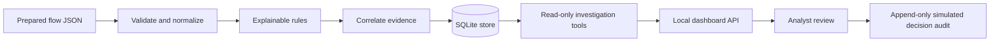

# SentinelMesh

SentinelMesh turns prepared network-flow records into explainable findings and evidence-linked incidents for local analyst review.

## Why it exists

Network alerts are easier to review when each signal points back to the flow records that produced it. SentinelMesh demonstrates that workflow for students and defenders using a small, deterministic rule set and synthetic data. It is a local defensive lab, not a production intrusion-detection service.

## Demo

Run the analyzer, then start the dashboard:

```bash
python scripts/generate_sample_data.py
python -m sentinelmesh.cli analyze
python -m sentinelmesh.cli serve
```

The server prints a fresh bearer token for that run. Keep the terminal private. Open `http://127.0.0.1:8000`; the dashboard uses that token for protected write actions. The demo only reads prepared JSON and records simulated analyst decisions. It does not capture packets or change a host or network.

## Quick start

Python 3.11 or 3.12 is required. The application itself uses only the Python standard library.

**Windows PowerShell**

```powershell
py -3.11 -m venv .venv
.\.venv\Scripts\Activate.ps1
python -m pip install -e ".[dev]"
python scripts/generate_sample_data.py
python -m sentinelmesh.cli analyze
python -m sentinelmesh.cli serve
```

**macOS**

```bash
python3.11 -m venv .venv
source .venv/bin/activate
python -m pip install -e ".[dev]"
python scripts/generate_sample_data.py
python -m sentinelmesh.cli analyze
python -m sentinelmesh.cli serve
```

**Linux**

```bash
python3.11 -m venv .venv
source .venv/bin/activate
python -m pip install -e ".[dev]"
python scripts/generate_sample_data.py
python -m sentinelmesh.cli analyze
python -m sentinelmesh.cli serve
```

Then visit `http://127.0.0.1:8000`. Stop the server with Ctrl+C. `python -m sentinelmesh.cli reset-demo` clears imported flow and investigation data while preserving the append-only audit log.

## Architecture



The ingestion layer rejects unknown fields, invalid timestamps and addresses, duplicate IDs, oversized files, and unsupported values. Rules emit findings with evidence flow IDs and observed values. Correlation groups related findings into stable incident IDs. The dashboard is served only on loopback; its state-changing endpoints require a random per-run bearer token and same-origin checks. SQLite protects its audit trail with append-only triggers and a hash chain.

## Results and measurements

The locally generated fixture contains 600 deterministic synthetic flow records generated with seed `41`; its generator is `scripts/generate_sample_data.py`. It intentionally includes routine flows and a few rule-triggering scenarios so the demo can be explored. These are not real-world traffic or measured detection efficacy.

| Measurement | Result | Method |
| --- | ---: | --- |
| Synthetic input records | 600 | Counted from the bundled JSON fixture |
| External datasets or services | 0 | Local-only demo; no network feed or model API |
| Findings / incidents | 25 / 1 | One run on the bundled fixture; deterministic rule output |
| Parse median | 8.065 ms | Five local runs, Python 3.13; includes JSON file read |
| Detection median | 1.877 ms | Five local runs, Python 3.13 |
| Correlation median | 0.441 ms | Five local runs, Python 3.13 |
| Detection quality on real traffic | Not measured | No labeled real dataset is included |

The five-run stage timings are machine-specific; the benchmark excludes SQLite and HTTP. Reproduce with `python scripts/benchmark.py --repeats 5`.

Generate the fixture with `python scripts/generate_sample_data.py --count 600 --seed 41`. The output is ignored by Git and is not committed. Use `--output` to write it elsewhere. Synthetic records are created by this repository, contain documentation/private IP ranges, and have no third-party dataset licence or redistribution terms. Do not treat them as representative operational traffic.

## Project structure

- `src/sentinelmesh/core/`: shared types and local settings.
- `src/sentinelmesh/ingest/`: JSON parsing and validation.
- `src/sentinelmesh/detection/`: explainable flow rules.
- `src/sentinelmesh/correlation/`: finding-to-incident grouping.
- `src/sentinelmesh/storage/`: SQLite records and audit chain.
- `src/sentinelmesh/investigation/`: evidence-bounded tools and report generation.
- `src/sentinelmesh/api/`: loopback HTTP service and dashboard endpoints.
- `src/sentinelmesh/cli.py`, `pipeline.py`, `service.py`: command entry point and orchestration.
- `frontend/`: static local dashboard.
- `data/generated/sample_flows.json`: ignored reproducible synthetic fixture and runtime data; generated by the script.
- `docs/`: architecture, input contract, workflow, safety, and threat model.
- `scripts/`: data fixture generator and Windows convenience runner.
- `tests/`: unit and HTTP integration tests.

See [How it works](docs/how-it-works.md), [data contract](docs/data-contract.md), [safety and data](docs/safety-and-data.md), and [threat model](docs/THREAT_MODEL.md).

## Development

```bash
python -m pip install -e ".[dev]"
python -m ruff check src tests
python -m ruff format --check src tests
python -m mypy src/sentinelmesh
python -m pytest -q
python scripts/benchmark.py --repeats 5
```

CI runs these checks and a CLI smoke analysis on Ubuntu and Windows with Python 3.11 and 3.12.

## Limitations

- Rules and scores are human-readable triage heuristics, not calibrated probabilities or proof of malicious activity.
- The sample is synthetic and intentionally small; there is no labeled real dataset, false-positive estimate, or real-world benchmark.
- Inputs are prepared flow JSON only. PCAP capture, packet payload inspection, Zeek/NetFlow ingestion, external threat intelligence, and external language models are not included.
- The API is intended for a single local user. It is not a multi-user or internet-facing service; do not bind it to a non-loopback address.
- “Simulated action” records analyst intent only. No endpoint, firewall, or network control is connected.

## Roadmap

1. Add more input adapters behind the existing validated flow contract.
2. Evaluate rule thresholds against a suitably licensed, labeled dataset without mixing synthetic and real results.
3. Add measurable performance and analyst-workload benchmarks before making operational claims.
4. Extend the review workflow only when access control and approval requirements are defined.
