# SentinelMesh architecture

## Data path

```mermaid
flowchart LR
    CLI[CLI or dashboard] --> API[Input boundary]
    API --> ING[Validate and normalize]
    ING --> DET[Explainable rules]
    DET --> COR[Evidence correlation]
    COR --> DB[(SQLite)]
    DB --> TOOLS[Read-only investigation tools]
    TOOLS --> REPORT[Observed facts and hypotheses]
    REPORT --> UI[Loopback dashboard]
    UI --> REVIEW[Human review]
    REVIEW --> AUDIT[Append-only simulated decision]
```

## Responsibilities

- `core`: immutable flow/finding contracts and paths/thresholds.
- `ingest`: bounded JSON decoding, schema checks, timestamp normalization.
- `detection`: deterministic baseline rules over validated records.
- `correlation`: deterministic incident identity and evidence grouping.
- `storage`: SQLite schema, append-only audit events, integrity verification, import batches.
- `investigation`: strict tool allowlist and reports grounded in stored evidence.
- `api`: loopback-only HTTP handling, dashboard assets, authorization and response headers.
- `pipeline`, `service`, and `cli`: orchestration and command entry points.

## Persistence and replay

Every analysis is an import batch. Existing flow IDs are idempotent only when their content is unchanged; reusing an ID for different content is rejected. Reports, approvals, and audit events are retained across imports. The separate `reset-demo` command clears demo records but preserves the hash-chained audit history. SQLite triggers reject updates and deletes on audit rows, and verification fails closed if the chain is incomplete or inconsistent.

## Trust boundaries

Input JSON is untrusted. Size, record count, types, known keys, timestamps, addresses, ports, protocol, and counters are validated before rules run. HTTP state changes require a random bearer token issued at startup and same-origin loopback requests. The server binds to loopback only. The investigator has no shell, filesystem, or network tool. Simulated responses are not connected to real controls.

## Deliberate constraints

The project uses the Python standard library at runtime and SQLite for a single-process demonstration. There is no packet capture, payload parser, network sensor, external model, user database, distributed worker, or production deployment claim. New dependencies and services should be introduced only when a measured requirement needs them.
