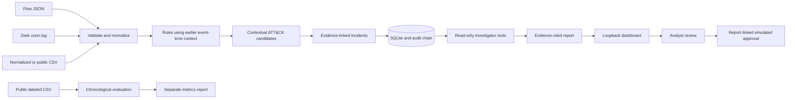

# SentinelMesh architecture

## Data path

## Responsibilities

- `core`: immutable flow/finding contracts and local settings.
- `ingest`: bounded JSON and Zeek parsing, normalized flow CSV, and CIC-IDS2017/UNSW-NB15 CSV loaders.
- `detection`: deterministic rules, event-time baselines, beaconing, and context-only ATT&CK mappings.
- `correlation`: stable incident grouping and optional NetworkX summaries of host links.
- `evaluation`: chronological 80/20 metrics and optional Isolation Forest comparison.
- `storage`: SQLite schema, import batches, reports, approvals, and append-only audit verification.
- `investigation`: allow-listed local reads, evidence reports, and an opt-in HTTPS LLM adapter without tools.
- `api`: loopback HTTP handling, dashboard endpoints, token checks, security headers, and low-cardinality metrics.
- `pipeline`, `service`, and `cli`: orchestration and command entry points.

## Persistence and replay

Existing flow IDs are idempotent only when content is unchanged; a changed record reusing an ID is rejected. Reports, approvals, and audit events are retained across imports. The explicit `reset-demo` command clears demo records but preserves the hash-chained audit history. SQLite triggers reject updates and deletes on audit rows, and verification fails closed if the chain is inconsistent.

## Trust boundaries

All ingest data is untrusted. Parsers enforce schema, size, row count, timestamps, addresses, protocol, and counter bounds. HTTP writes require a random bearer token and same-origin loopback request; the server binds to loopback. LLM assistance is off by default; when enabled it sends evidence over HTTPS to a configured provider, exposes no callable tools, and rejects claims that cite unknown evidence IDs. Do not enable it for data you are not authorized to transmit.

## Deliberate constraints

SQLite and the in-memory process metrics fit a single-process local demo. There is no live capture, packet-payload parsing, distributed worker, production authentication, or response-control integration. Graph summaries are not graph learning. Isolation Forest is a comparison model, not an operationally calibrated detector. Public data evaluation requires local downloads; no external dataset is checked in.

ATT&CK tags are candidates attached to rule output, never confirmed adversary behavior. Viewer access is read-only. The analyst token is a local write gate, not an identity system. Simulated approvals require a report, reference it, and record a 30-minute expiry without taking action.
